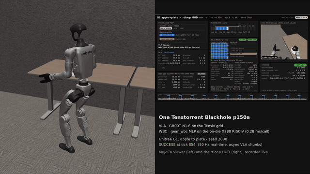

# GR00T-WholeBodyControl-TT (rtloop)

A VLA and an RL whole-body policy running together on one Tenstorrent Blackhole p150a, driving a Unitree G1 in
MuJoCo (GR00T-WholeBodyControl, apple-to-plate). GR00T N1.6 runs on the Tensix grid; the gear_wbc lower-body MLP
runs every 50 Hz tick on the chip's on-die SiFive X280 RISC-V cores. The control loop is shaped like a real robot's:
the WBC runs every tick while the VLA produces 30-row action chunks asynchronously in the background.

## Demo

One Blackhole p150a runs the whole stack: GR00T N1.6 on the Tensix grid, the gear_wbc whole-body MLP on the chip's
X280 (L2CPU3, 800 MHz, 0.385 ms per call), the 50 Hz loop on the host. Left: the MuJoCo viewer; right: the live HUD
(processor map, Blackhole panel with the Tensix megakernel layout and the X280 status, ego view of the active chunk).
Full-resolution recordings (1920x1080): [seed 2000, success at tick 854](https://github.com/changh95/GR00T-WholeBodyControl-TT/releases/download/demo-videos/g1_tensix_vla_x280_wbc_seed2000.mp4),
[seed 2009, success at tick 1283](https://github.com/changh95/GR00T-WholeBodyControl-TT/releases/download/demo-videos/g1_tensix_vla_x280_wbc_seed2009.mp4).

| Milestone | VLA | WBC | Status |
|---|---|---|---|
| M1 | RTX 5090 | RTX 5090 (CUDA graph) | done: async loop costs no success (T-1.9), RT timing 18/18 (T-1.4) |
| M2 | Blackhole Tensix | RTX 5090 | done: TT vs GPU no success drop (T-2.5, T-2.7), 2 h RT soak 20/20 (T-2.8) |
| M3 | Blackhole Tensix | Blackhole X280 (L2CPU3) | closed loop passes (T-3.7); fault recovery (T-3.8) and the 2 h demo soak (T-3.9) in progress |
| next | | X280, 4 tiles x up to 4 harts | single-hart kernel optimisation, then tensor-parallel across L2CPU0-3 |

Results: `docs/plan/vla-wbc-x280/results/` (M1.md, M2.md). Design and test plan: `docs/plan/vla-wbc-x280/PLAN.md`.
Module contracts: `INTERFACES.md`. Test suites and how to run them: `TESTING.md`.

## Layout

- `rtloop/` the 50 Hz loop (splicer, VLA/WBC clients, telemetry, viewer process); `rtserve/` GPU VLA and WBC servers
- `rttt/` the TT VLA server (`server_g1.py`) on the tt-metal megakernel GR00T port
- `x280/` the X280 side: firmware (`fw/`: crt0, monitor, kernels, stage-0 LIM initialiser, multi-hart runtime),
  host layer (`host/kmd.py`, `host/wcio.c`), register map and write allowlist (`regs.py`), daemon (`x280d.py`), simulators
- `scripts/` demo, HUD, chip sessions, analysis; `jobs/` device-session jobs; `tests/` CPU, sim, spike and fake-device suites
- `third_party_refs/SHAS.txt`, `x280/refs/SOURCES.txt`: the upstream sources the code cites (fetch them; not vendored)

## Setup

`source env.sh` defines the interpreter wrappers (`simpy`, `srvpy`, `ttpy`, `xpy`), ports and paths. Device access
goes only through the guarded wrappers `$DEV` / `$DEVX` (`chip_session.sh`); every X280 hold resets the chip after.

## Findings worth knowing

- Host NoC writes cannot initialise X280 LIM: the CCACHE pre-reads uninitialised SRAM and poisons the ECC, and the
  poison survives `tt-smi -r`. A hart-side stage-0 zero-fill (E1F) fixes it; it is the standard boot.
- One X280 hart streams LIM at ~6.4 GB/s, the tile's whole read port; the MLP at 0.385 ms uses ~41% of it.
- The tt-metal snapshot's `ttnn` must run with `TT_METAL_RUNTIME_ROOT` pinned, or the device compiles another tree's kernels.
